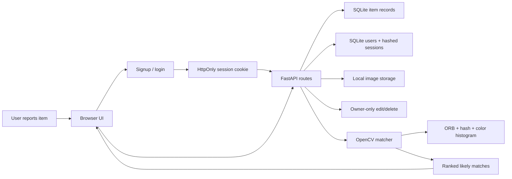

# Recovr

Recovr is a lost-and-found web app that uses OpenCV to match uploaded item photos against active lost and found reports. It is designed as a scoped SWE intern portfolio project: simple to run, easy to review on GitHub, and technical enough to discuss system design, APIs, computer vision, testing, privacy, and product tradeoffs.

## Highlights

- Report lost or found items with category, location, campus zone, date, and a photo.
- Automatically rank likely matches from the opposite report type.
- Explain each match score with image and metadata signals.
- Search active listings by text, category, type, campus zone, and cursor.
- Hide contact details in public listing and match responses.
- Start on a polished landing page, create an account or log in, then browse open reports.
- View your own posts, edit listing details, mark items resolved, and delete stale reports.
- Store passwords as salted PBKDF2-HMAC-SHA256 hashes and sessions as HttpOnly cookies backed by server-side records.
- Use the REST API directly through FastAPI's generated docs.
- Run deterministic tests with generated images.
- Start locally with Python or Docker.

## Tech Stack

- Backend: FastAPI
- Storage: SQLite plus local image uploads for development; Supabase Postgres and Storage for hosted deployments
- Computer vision: OpenCV ORB features, perceptual hashing, HSV histograms
- Frontend: server-rendered HTML with vanilla JavaScript
- Testing: pytest, FastAPI TestClient, generated OpenCV fixtures

The UI follows the Recovr Figma direction: an off-white paper landing page, thin sketch-like borders, serif headings, muted blue-gray action states, a real login gate, and listing cards styled like scanned logbook entries.

The referenced product spec describes a larger production system with Next.js, Django REST Framework, PostgreSQL, pgvector, Redis, Celery, object storage, auth, messaging, and notifications. This repository intentionally implements the recruiting MVP path first: local setup, full listing-to-match flow, privacy-aware public responses, and a documented upgrade path. See [docs/SPEC_ALIGNMENT.md](docs/SPEC_ALIGNMENT.md).

## Architecture



The matching pipeline intentionally uses explainable image retrieval instead of a downloaded black-box model. For each image, Recovr computes:

- ORB descriptors for local visual details.
- An average perceptual hash for coarse object shape.
- An HSV color histogram for dominant color similarity.

Scores are weighted and returned with a short explanation such as `features=0.62, shape=0.84, color=0.77`.

More detail is in [docs/ARCHITECTURE.md](docs/ARCHITECTURE.md).

Hosting setup is in [docs/HOSTING.md](docs/HOSTING.md).

## Quick Start

```bash
python3 -m venv .venv
source .venv/bin/activate
python -m pip install --upgrade pip
python -m pip install -e ".[dev]"
uvicorn app.main:app --reload
```

Open:

- App: http://127.0.0.1:8000
- API docs: http://127.0.0.1:8000/docs

From the landing page, choose **Log in**, switch to **Create account**, and create a local account. The app will attach your account identity to new reports and keep contact details out of public API responses.

## Docker

```bash
docker compose up --build
```

Then open http://127.0.0.1:8000.

## Publish to GitHub

```bash
git init
git add .
git commit -m "Build Recovr OpenCV lost-and-found MVP"
git branch -M main
git remote add origin https://github.com/Zashaan/Recovr.git
git push -u origin main
```

If you use the GitHub CLI, replace the remote steps with:

```bash
gh repo create Recovr --public --source=. --remote=origin --push
```

## Tests

```bash
pytest
ruff check .
```

The tests create simple synthetic item photos and verify that visually similar items score higher than unrelated ones.

## Authentication and Security

Recovr stores users in SQLite for the MVP. Passwords are never stored directly: each password is hashed with a unique salt using PBKDF2-HMAC-SHA256. Login creates a random session token, stores only its SHA-256 hash server-side, and sends the original token to the browser in an `HttpOnly`, `SameSite=Strict` cookie. Public listing and match responses redact internal user ids and contact details.

For local development, `LOSTFOUND_COOKIE_SECURE=false` allows cookies over `http://127.0.0.1`. In production, run behind HTTPS and set `LOSTFOUND_COOKIE_SECURE=true`.

## API Examples

Create a report:

```bash
curl -c cookies.txt -X POST http://127.0.0.1:8000/api/auth/signup \
  -F display_name="Alex" \
  -F email="alex@example.com" \
  -F password="correct-horse-battery"

curl -X POST http://127.0.0.1:8000/api/items \
  -b cookies.txt \
  -F kind=lost \
  -F title="Black Hydro Flask" \
  -F description="Bottle with two laptop stickers" \
  -F category=other \
  -F color=black \
  -F location="Engineering library" \
  -F campus_zone="engineering" \
  -F event_date="2026-08-21" \
  -F image=@/path/to/photo.jpg
```

Get matches:

```bash
curl http://127.0.0.1:8000/api/v1/listings/{item_id}/matches
```

Search active listings:

```bash
curl "http://127.0.0.1:8000/api/v1/listings?type=found&category=keys&q=dorm&campus_zone=north"
```

List your own posts:

```bash
curl -b cookies.txt http://127.0.0.1:8000/api/items/mine
```

Update one of your posts:

```bash
curl -X PATCH http://127.0.0.1:8000/api/items/{item_id} \
  -b cookies.txt \
  -F title="Updated Hydro Flask" \
  -F status=resolved
```

Delete one of your posts:

```bash
curl -X DELETE http://127.0.0.1:8000/api/items/{item_id} -b cookies.txt
```

## Project Scope and Tradeoffs

This MVP optimizes for a clean recruiting demo:

- SQLite is enough for local demos and GitHub review.
- Local image storage avoids cloud credentials.
- OpenCV matching is transparent and works without a training dataset.
- Accounts, private contact details, and server-side sessions are implemented without external identity dependencies.
- Pairwise scoring is acceptable for small campus-scale demos; production should cache signatures and use vector search.

Production improvements would include email verification, password reset, CSRF tokens for cross-site deployments, in-app messaging, Cloudflare R2/S3 storage, saved image embeddings, approximate nearest-neighbor search with pgvector, admin moderation, daily match digests, and a semantic embedding model such as CLIP or MobileNet.

## Repository Structure

```text
app/
  api.py                 FastAPI JSON routes
  db.py                  SQLite schema and connection helpers
  main.py                app startup and web UI route
  repository.py          persistence functions
  services/
    image_store.py       upload handling
    matcher.py           OpenCV image matching
    search.py            candidate ranking
  static/                browser UI assets
  templates/             HTML template
docs/
  ARCHITECTURE.md        system design and scaling notes
  PORTFOLIO_COPY.md      resume and website descriptions
tests/                   matcher and API tests
```

## Portfolio Positioning

Use the copy in [docs/PORTFOLIO_COPY.md](docs/PORTFOLIO_COPY.md) for resume bullets, a personal website description, and a GitHub tagline.
